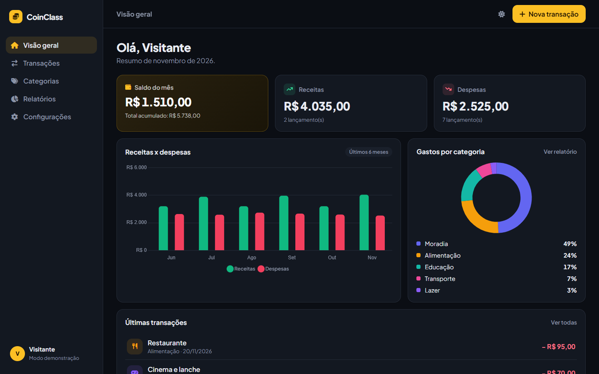
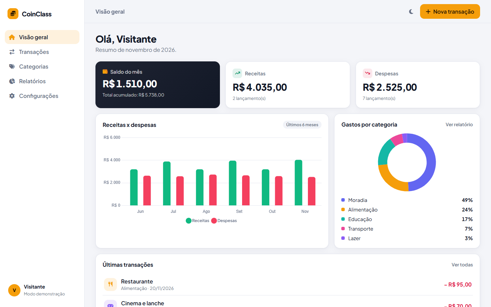
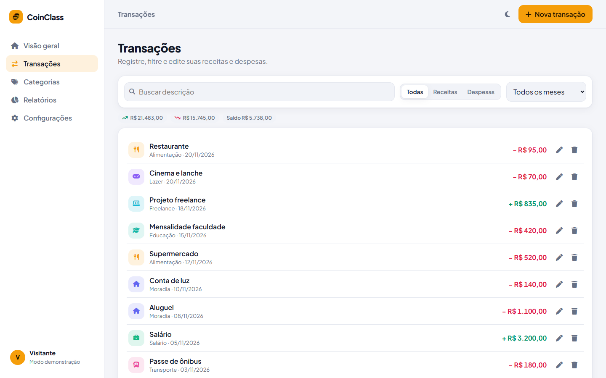
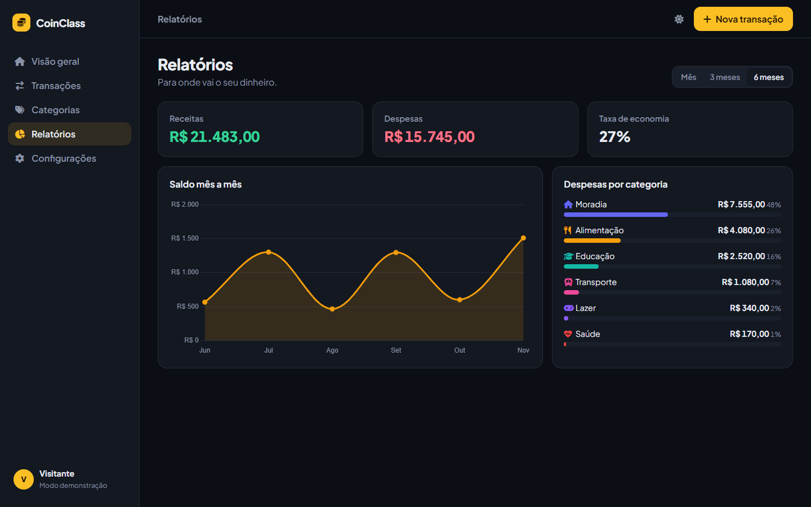
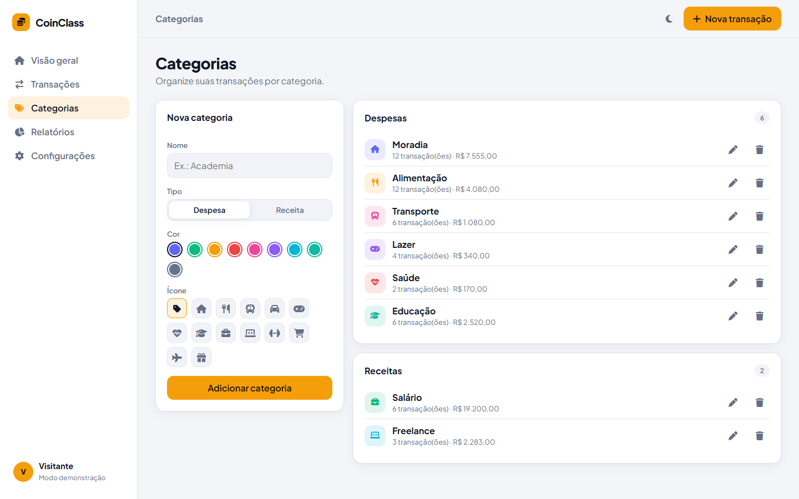
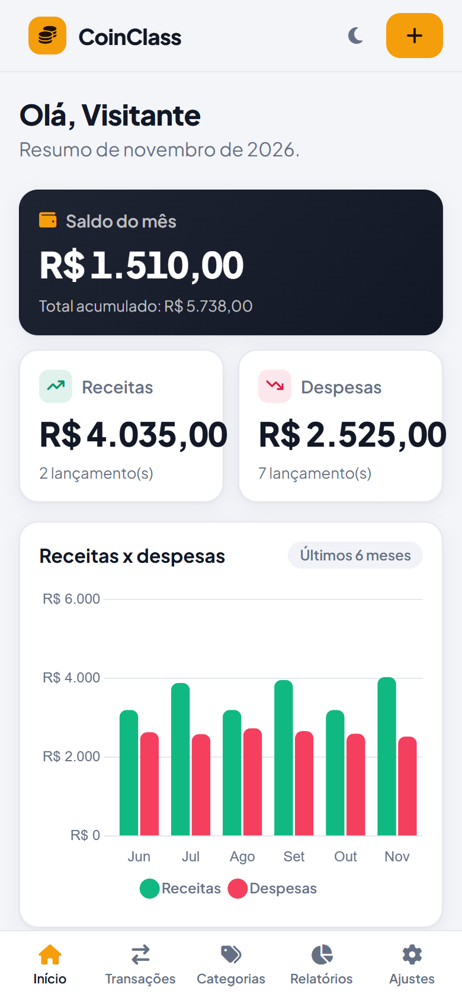
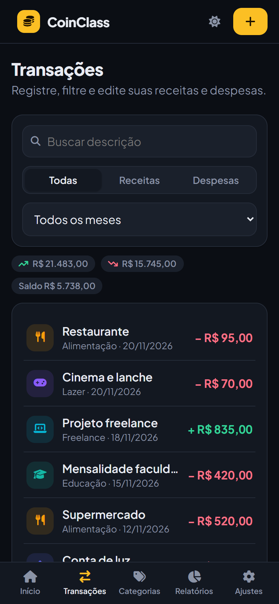
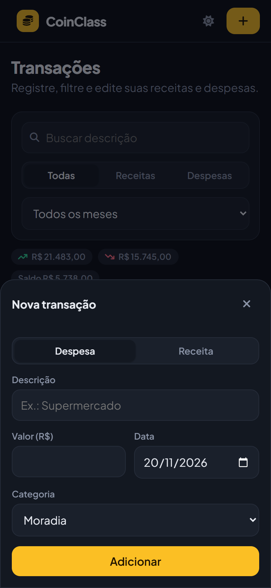
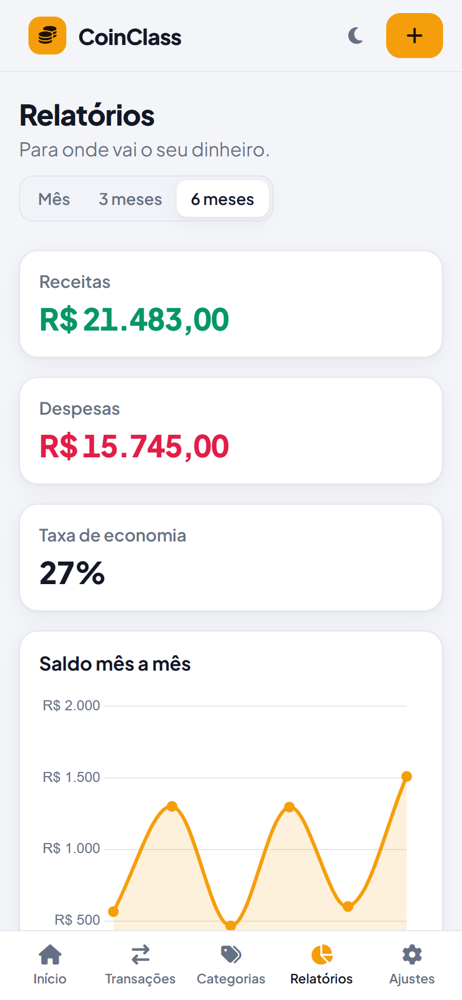

# CoinClass

Gerenciador financeiro pessoal: registre receitas e despesas, organize por categorias e acompanhe o mês em gráficos.

**Demo:** https://chavesz.github.io/coinclass/



## Funcionalidades

- **Visão geral:** saldo do mês, receitas, despesas, gráfico dos últimos 6 meses e gastos por categoria
- **Transações:** adicionar, editar e excluir, com busca e filtros por tipo e por mês
- **Categorias:** criar e editar categorias de receita e despesa, com cor e ícone
- **Relatórios:** saldo mês a mês, taxa de economia e ranking de despesas por categoria
- **Configurações:** perfil, tema claro/escuro/sistema e exportação das transações em CSV
- Layout responsivo, com navegação inferior no celular

Os dados ficam salvos no navegador (localStorage). Na primeira visita o app carrega **dados de exemplo** para demonstração; dá para restaurá-los ou apagá-los em Configurações.

## Prints

| Desktop | |
|---|---|
|  |  |
|  |  |

| Celular | | | |
|---|---|---|---|
|  |  |  |  |

## Stack

- [Vue 2](https://v2.vuejs.org/) + Vue Router
- [Chart.js](https://www.chartjs.org/) para os gráficos
- CSS próprio com variáveis (tema claro e escuro)
- Font Awesome para os ícones
- Vue CLI (build) e GitHub Pages (demo)

## Como rodar

Requer Node.js 14 ou superior.

```bash
cd front
npm install
npm run serve      # http://localhost:8080
```

Build de produção:

```bash
npm run build      # gera front/dist
```

## Estrutura

```
front/src
├── App.vue              # layout: barra lateral, topo e navegação no celular
├── store.js             # estado, persistência e dados de exemplo
├── components/          # AppChart, TxRow
└── views/               # Visão geral, Transações, Categorias, Relatórios, Configurações, Entrar/Cadastro
```

## Autor

Kauã Chaves — [github.com/Chavesz](https://github.com/Chavesz)
